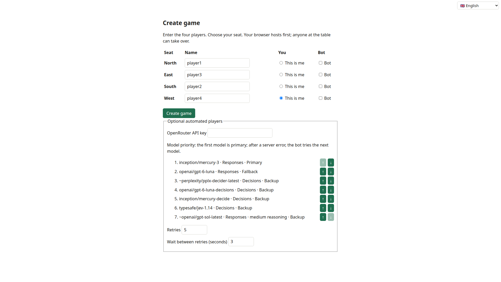
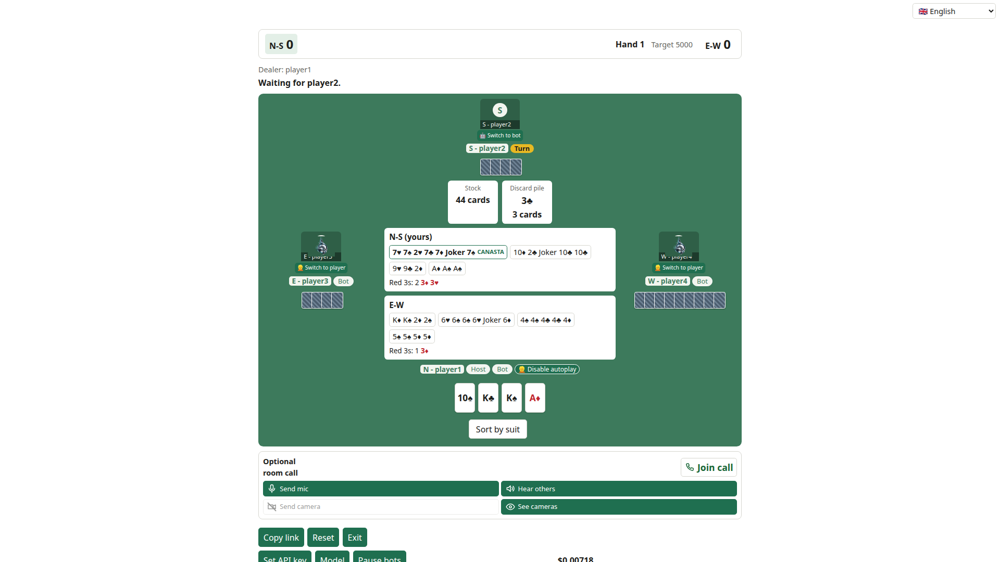

# Open Canasta

Open Canasta is a four-player partnership canasta game that runs in the browser.
It supports human players, optional voice and video calls, and AI players powered by OpenRouter.
The game deals the cards, offers only legal actions, and keeps the score of the match.

**Source:** [github.com/dvolgyes/open_canasta](https://github.com/dvolgyes/open_canasta)

The game is a static site with no game server or database.
Players connect through public WebTorrent trackers, then exchange game data directly over WebRTC.
One browser coordinates the table at a time; every seated browser stores a copy so another can take over if needed.
The table key is in the link fragment and is not sent to the web server.

## How to play

Open Canasta is a classic four-player partnership canasta table.
North and South form one side, and East and West form the other.
The game uses two decks with four jokers, 108 cards in total.
The first side to reach 5000 points wins the match.

### Create a table and invite friends

1. Open Open Canasta and fill in a name for each seat: North, East, South, and West.
2. Select **This is me** beside the seat you want to play.
3. Select **Create game**.
   Your browser creates the table, takes your seat, and copies the room link when clipboard access is available.
4. Use **Copy link** at the table to copy the shared link again, then send the full link to your friends in a private message.
5. Each friend opens the link and selects one of the available seats.
   If only one seat remains, Open Canasta takes it automatically.



The room link is the invitation key.
Room discovery can announce that a room exists, but a person still needs the complete link to join because the room password is carried in the link fragment.
Treat the full link like a password: send it only to people you want at the table.
Do not post it publicly.

### Take a seat and play

The room opens at a seat-selection screen when more than one seat is free.
Choose the seat the host agreed with you.
If a seat is already held by an active browser, choose another available seat or ask its player to release it.
Reopening the link in the same browser normally restores that browser's seat.

When all four seats are ready, the table deals the first hand automatically: eleven cards to each player.
North deals the first hand, and the player at the dealer's left starts.
In each turn, a player does these steps:

1. Draw the top card of the stock, or take the whole discard pile.
2. Optionally meld: lay down sets of three or more cards of the same rank, or add cards to the side's melds.
3. Discard one card, unless the player goes out.

The table offers only legal actions.
Select cards in your hand to see the melds, extensions, and discards that use them.



The main rules, in short:

- Jokers and 2s are wild cards.
  A meld needs at least two natural cards, and it can hold at most three wild cards.
- A canasta is a meld of seven or more cards.
  A natural canasta (no wild cards) scores 500, and a mixed canasta scores 300.
  A side must have at least one canasta before one of its players can go out.
- A side's first meld in a hand must reach a minimum count, which depends on the side's score: 50 points from 0, 90 from 1500, and 120 from 3000.
  A side with a negative score needs only 15.
  When a player takes the pile for the first meld, the top card counts toward the minimum, but the rest of the pile does not.
- A red 3 is set aside at once, and the player draws a replacement.
  Each red 3 scores 100 for its side, or subtracts 100 if the side has not melded in that hand.
  All four red 3s on one side score 800.
- A black 3 discard blocks the next player from taking the pile.
- To take the pile, a player melds its top card: with two matching cards from the hand, with one matching card and a wild card, or on a meld of the side.
- A pile with a wild card in it is frozen.
  The pile is also frozen for a side that has not melded yet.
  A frozen pile can be taken only with two natural cards from the hand that match its top card.
- The hand ends when a player goes out, or when the stock runs out and the next player cannot take the pile.
  Going out scores 100, or 200 when the player goes out in one turn without an earlier meld.
  Cards still in a hand count against their side.

After a hand ends, the table shows the score for 10 seconds, then the host deals the next hand.
The exact rules and the points that differ between published variants are in [ADR 0007](docs/adr/0007-canasta-engine-written-here.md).

You must take one of the four player seats to use the table.
There is no spectator or kibitz mode, so people who are not seated cannot watch the cards from inside the room.

### Reset the match

**Reset** clears the scores and starts a new match with the same players.
Every other player at the table must approve the reset; one rejection cancels it.
The player who asked can cancel the request.
The game waits while a reset request is open.
The chat and the call stay as they are.
After a side wins the match, use **Reset** to play again.

### Use bots

Bots can fill seats for a game, or the host can turn on autoplay for a player who needs to step away temporarily.
For a permanent bot seat, select **Bot** for that seat while creating the table.
For a temporary substitute, the host can enable the bot for the player's seat from the table controls, then turn it off when the player returns.
The player keeps their seat and stays in the room call while the bot handles canasta actions.
Bots approve a reset request automatically.

OpenRouter is a service that provides access to AI models from many providers through one API.
Bot play can cost money because AI model requests may be billed; the table displays the accumulated OpenRouter cost as you play.
You bring your own [OpenRouter API key](https://openrouter.ai/).
Enter the key in the create screen when setting up bot seats, or in the table's bot controls before enabling a substitute.
The key is stored in the host browser and is not included in the shared room link.
If the current host has no usable key, bot play is unavailable until a host with a key takes over or the key is set.
You can choose the model order and retry settings when creating the room.
A bot chooses from a numbered list of the legal actions.
If the model gives no usable answer, the bot uses a simple built-in heuristic for that turn.

### Call and finding players

The table includes an optional audio and video call for room members.
Each player chooses whether to join the call and whether to send a microphone or camera.
On mobile phones, video calls are intentionally unavailable because the screen has limited space; audio calls remain available.
The call is separate from canasta actions, so using autoplay does not make the player leave the call.
The call has no kibitz or spectator access.

Open Canasta does not currently provide matchmaking or a way to find random players online.
You need to invite people yourself and share the room link with them.

### Save and reuse a room link

You can bookmark or save the shared table link and reuse it with regular partners.
The link keeps the seat names and table setup, so it can start a fresh table for the same group without creating and distributing another invitation.
The current game state is stored in the players' browsers, not on a game server.
After about 24 hours without activity on a device, its saved table expires; starting again from the saved link creates a fresh session and does not restore the previous hand, score, or seat claims.
Use **Copy link** in the table if you need to share the invitation again.

### Fair play

Every seated browser stores the whole table state, including the other hands and the stock, so that any player can take over as the host.
The screen hides the cards that a player must not see, but a player who inspects the browser's storage or network traffic can see them.
The game is meant for friends who trust each other.
[ADR 0008](docs/adr/0008-module-boundaries.md) records this decision.

## Development

The game is TypeScript, built with Vite.
See [CLAUDE.md](CLAUDE.md) for the module map and the commands for tests and checks.

```sh
npm install
npm run dev        # local development server
npm run build      # type check and production build into dist/
npm test           # unit tests and browser tests
npx playwright test  # end-to-end tests with several browsers
```

## License

Open Canasta is all rights reserved.
The source code and original assets are not licensed for reuse or independent hosting.
Third-party components keep their own licenses.
See [LICENSE](LICENSE) for the terms.
GitHub's terms still allow users to view and fork a public repository ([GitHub licensing documentation](https://docs.github.com/en/repositories/managing-your-repositorys-settings-and-features/customizing-your-repository/licensing-a-repository)).
